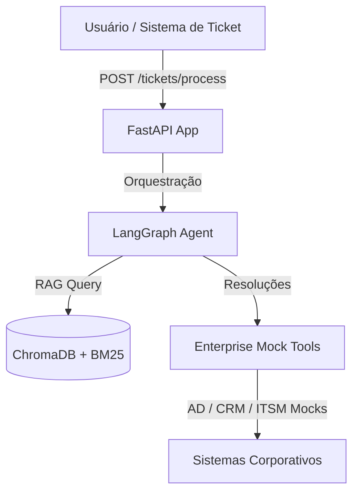

# 🎫 Portfolio-Ticket — Triagem Inteligente de Chamados

Microsserviço de IA que recebe chamados de suporte, busca contexto relevante numa base de conhecimento interna usando RAG e sugere respostas de forma totalmente autônoma. Projetado para funcionar integrado a sistemas de helpdesk corporativos.

---

## 📋 Índice

- [Visão Geral](#-visão-geral)
- [Estrutura do Repositório](#-estrutura-do-repositório)
- [Endpoints da API](#-endpoints-da-api)
- [Como Executar](#-como-executar)
- [Documentação Detalhada](#-documentação-detalhada)

---

## 💡 Visão Geral

Este projeto automatiza a triagem e resolução de tickets de suporte combinando **Busca Híbrida Semântica/Lexical (RAG)** com **Agentes Autônomos (LangGraph)** que decidem quando consultar documentos internos ou acionar ferramentas do sistema (IAM/Active Directory, ITSM e CRM) de forma assíncrona.



---

## 📁 Estrutura do Repositório

```text
Portfolio-Ticket/
├── app/
│   ├── main.py                  # API FastAPI (Rotas HTTP e setup da app)
│   ├── core/
│   │   └── observability.py     # Inicialização de Rastreamento (OTel), Logs (Loki) e Métricas (Prometheus)
│   ├── services/
│   │   └── rag_service.py       # Busca Híbrida RAG (ChromaDB + BM25 Okapi)
│   └── agents/
│       ├── tools.py             # Ferramentas corporativas mockadas (AD, CRM, ITSM)
│       ├── graph_agent.py       # Agente Autônomo Principal (LangGraph)
│       └── agentscope_agent.py  # Agente Alternativo (AgentScope 2.0)
├── data/
│   └── policies/                # Políticas de suporte indexadas pelo RAG
├── docs/                        # Documentação do projeto (Arquitetura, Observabilidade, Qualidade)
│   ├── architecture.md          # Decisões de arquitetura e trade-offs
│   ├── observability.md         # Rastreamento de traces com Grafana + Tempo + Loki
│   ├── rag_knowledge_base.md    # Estrutura do banco vetorial RAG
│   └── evaluation.md            # Avaliação de qualidade do RAG
├── docker-compose.yml           # Stack Grafana (LGTM-lite local)
├── requirements.txt             # Dependências Python
└── README.md                    # Este arquivo (Visão Geral e Setup)
```

---

## 📡 Endpoints da API

| Método | Rota | Descrição |
|---|---|---|
| `GET` | `/` | Health check |
| `POST` | `/api/v1/tickets/process` | Processa chamado e retorna a resposta do Agente |
| `POST` | `/api/v1/documents` | Upload de arquivo `.md` para indexar no RAG |
| `GET` | `/api/v1/documents` | Lista documentos indexados no RAG |
| `DELETE` | `/api/v1/documents/{doc_id}` | Remove documento do RAG pelo ID |

### Exemplos rápidos de uso:

**Processar um ticket:**
```bash
curl -X POST http://localhost:8000/api/v1/tickets/process \
  -H "Content-Type: application/json" \
  -d '{"ticket_id": "TK-001", "texto": "Minha conta foi bloqueada depois de errar a senha"}'
```

---

## 🚀 Como Executar

### 1. Requisitos
* Python 3.10+
* Docker e Docker Compose (para visualização de telemetria)

### 2. Passo a Passo
```bash
# Criar e ativar o ambiente virtual
python3 -m venv .venv
source .venv/bin/activate

# Instalar dependências
pip install -r requirements.txt

# Configurar as chaves e variáveis de ambiente
export MINIMAX_API_KEY="sua-chave-aqui"
export OTEL_EXPORTER_OTLP_ENDPOINT="http://localhost:4317" # Caso queira Tracing no Docker

# Iniciar o servidor
uvicorn app.main:app --reload
```
A API estará disponível em `http://localhost:8000`. Acesse a documentação interativa em `http://localhost:8000/docs`.

### 3. Subir Stack de Observabilidade (Opcional)
Se quiser acompanhar os traces das chamadas de ferramentas e logs detalhados:
```bash
docker compose up -d
```
Acesse o Grafana em `http://localhost:3000` (User/Password: `admin` / `admin`).

---

## 📖 Documentação Detalhada

Para ir a fundo no funcionamento técnico deste projeto, consulte:
1. **[Decisões de Arquitetura e Trade-offs](docs/architecture.md)**: Justificativa de uso do LangGraph vs AgentScope, fluxo de decisão autônoma do agente e design da busca híbrida.
2. **[Guia de Observabilidade Híbrida](docs/observability.md)**: Como funciona o rastreamento OTel com Grafana Tempo, Loki e Prometheus no localhost + Docker.
3. **[Design do RAG & Vetores](docs/rag_knowledge_base.md)**: Funcionamento dos embeddings e o processo de busca híbrida com RRF.
4. **[Avaliação de Qualidade do RAG](docs/evaluation.md)**: Análise de revocação e eficácia das respostas baseadas nas políticas.
